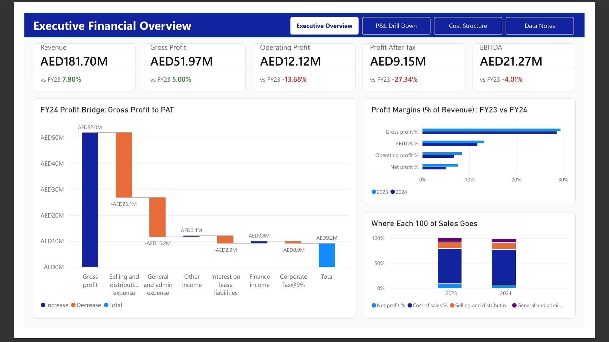
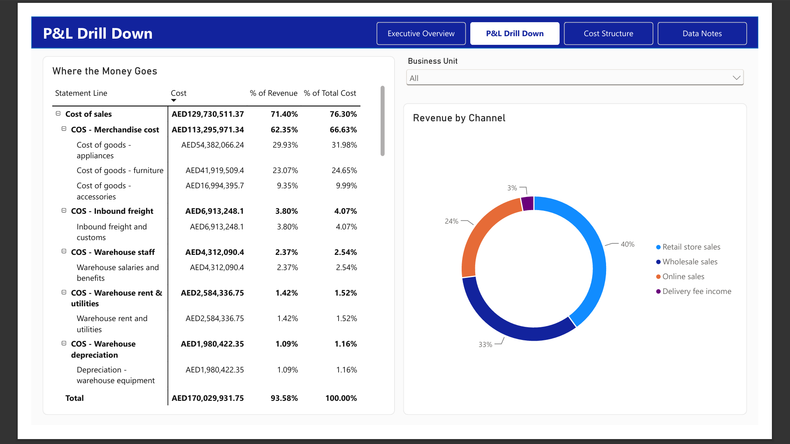
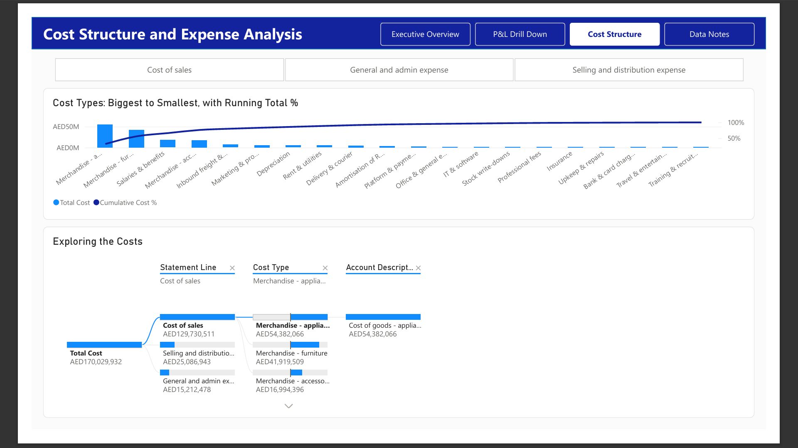
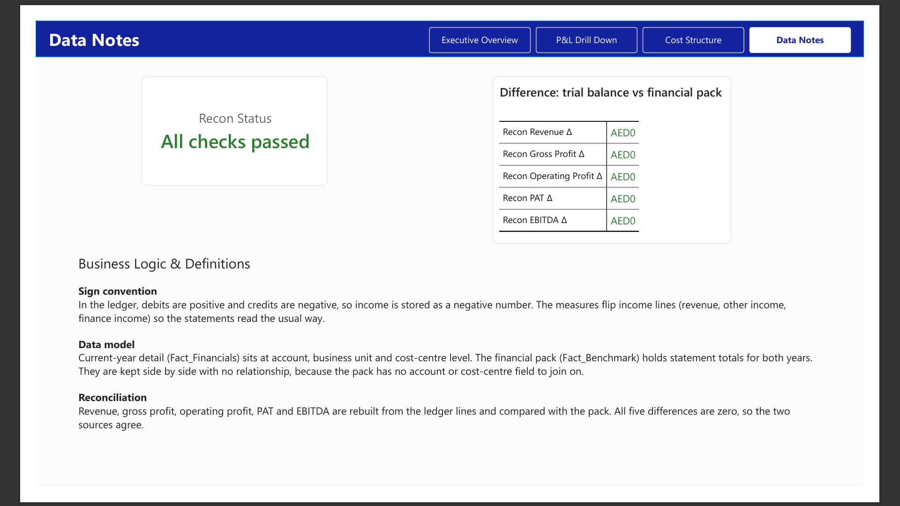

# P&L Performance and Variance Analysis Dashboard

A Power BI dashboard that turns a trial balance and a financial pack into an income statement analysis for a fictional home-retail company. It answers the questions a finance team asks after a reporting period: how did we do against last year, what drove the change in profit, and where does the cost sit?

You can drill from the income statement down to individual accounts and cost centres. It is built on two sources at different levels of detail: a financial pack with summary lines for both years, and a trial balance with account-level balances for FY2024. The data is synthetic. The company and every figure are made up.

**Focus areas:** financial statement analysis (income statement, EBITDA, margins), year-on-year variance analysis, cost driver analysis, ledger-to-statement mapping and reconciliation checks. Built with Power BI, DAX and Power Query.

## Preview






## What the report shows

Revenue rose 7.9% to AED 181.7M, yet net profit (PAT) fell 27.3% to AED 9.15M.

- Cost of sales rose 9.1%, a bigger increase than revenue, so gross margin dropped from 29.4% to 28.6%.
- Selling and distribution costs rose 11.2% and admin costs 7.2%. Operating profit fell 13.7% to AED 12.1M.
- Net profit fell by AED 3.44M. Lower EBITDA explains 26% of that, higher depreciation and lease amortisation 32%, higher lease interest 17%, and a new 9% corporate tax charge 25% (the pack has no tax line for FY2023).
- Merchandise makes up about two thirds of total cost, and the five largest cost types account for about 80%.

## Data model

| Table | Grain | Contents |
|---|---|---|
| `Fact_Financials` | One row per account and cost-centre combination (216 rows) | FY2024 trial balance amount and the cost centre key |
| `Dim_Combination` | Same grain | Account, statement line, line detail, cost type, business unit, cost centre |
| `Fact_Benchmark` | One row per metric and year | Financial pack lines for FY2023 and FY2024 |
| `_Measures` | n/a | All DAX, grouped in display folders |

`Dim_Combination` relates to `Fact_Financials` one-to-one on the cost centre key. A business unit or cost centre appears on many accounts, so the only unique identifier is the full combination of account, business unit and cost centre.

`Fact_Benchmark` has no relationship to the other tables, and that is intentional. The pack has no account or cost-centre attribute to join on, so a relationship would be artificial. The measures that read from it filter metric and year explicitly.

## Data engineering

A staging query cleans the trial balance once. `Fact_Financials` and `Dim_Combination` both read from it, and it is not loaded into the model itself.

- Removed the top rows, promoted the headers and dropped the helper columns.
- Typed every identifier (account, division, cost centre, combination key) as text, so codes keep their leading zeros, for example division `00`.
- Profiled the combination key before building the relationship: 216 rows, 216 distinct values.
- Kept the ledger signs as they are in the source. Sign handling is done in DAX, so the data stays auditable.

The pack is prepared in `Fact_Benchmark`:

- Filtered out blank and error rows and added an index to preserve statement order.
- Unpivoted the year columns into `Metric`, `Year` and `Value`.
- Standardised metric labels so both years use the same names.
- Gave the EBITDA add-back rows their own labels. They repeat the names of P&L lines such as tax and lease interest with the opposite sign, so left alone they cancel the real lines when summed.

The report includes a Data Notes page. It rebuilds revenue, gross profit, operating profit, PAT and EBITDA from the ledger lines and compares each with the pack. All five differences are zero.

## Business logic

- **Sign convention.** The ledger stores debits as positive and credits as negative, so income is a negative number. The measures flip income lines (revenue, other income, finance income) so statements read the usual way. A positive balance on an income account therefore means a net cost.
- **Statement build.** Revenue less cost of sales gives gross profit. Less selling and distribution and general and admin costs, plus other income, gives operating profit. Less lease interest, plus finance income, gives profit before tax. Less corporate tax gives PAT.
- **EBITDA.** PAT plus tax, lease interest, depreciation and right-of-use amortisation. This follows the definition used in the pack, where finance income is not deducted.
- **Two views of cost.** Costs are classified by function (cost of sales, selling and distribution, admin) and by nature (merchandise, salaries, depreciation and so on). Both live in the model, so any cost can be sliced either way.
- **Percent of revenue.** The denominator is always total revenue, even when you drill into a single line, so ratios stay comparable at every level.

## DAX notes

- `Total Cost` uses `KEEPFILTERS`. Statement-line and slicer selections then intersect with the cost filter instead of replacing it. Before the fix, every statement line showed the all-cost total.
- `Revenue (All)` clears dimension filters to give `Cost % of Revenue` a fixed denominator.
- `Cumulative Cost %` ranks cost types by amount for the Pareto chart and responds to slicers through `ALLSELECTED`.
- Prior-year measures read from `Fact_Benchmark` with explicit metric and year filters. Year-on-year percentages use `DIVIDE`.
- Reconciliation measures compare the ledger-based P&L with the pack and drive the status card on the Data Notes page.

## Report pages

| Page | What it contains |
|---|---|
| Executive Overview | Five KPI cards with year-on-year change, a waterfall from gross profit to PAT, a margin comparison for FY2023 and FY2024, and a chart of where each 100 of sales goes |
| P&L Drill Down | A matrix that opens from cost group to line detail to account, with cost, % of revenue and % of total cost. Also revenue by channel and a division slicer |
| Cost Structure | A Pareto chart of cost types with running total, cost group tiles, and a decomposition tree from statement line to cost type to account |
| Account Details | Hidden drill-through page. Right-click an account on the drill-down page to see its cost-centre lines |
| Data Notes | Reconciliation status and the business logic definitions |

## Design decisions and scope

- The pack holds FY2023 at summary level only, so year-on-year analysis works at statement-line level. The account-level drill-down covers FY2024.
- The trial balance also contains balance sheet accounts. This report concentrates on the income statement.

## Repository

```
dashboard/     the .pbix file
data/          the Excel workbook (financial pack and trial balance)
docs/          PDF export of the report
screenshots/   images used above + hidden drill-through page
```

## Running it

Open the `.pbix` file in Power BI Desktop. It uses import mode, so the data is included. To refresh from the workbook, go to Transform data, then Data source settings, and point to the file in `data/`.

## Author

Amritha Gopakumar. Microsoft Certified: Power BI Data Analyst Associate (PL-300), with a background in data engineering using SQL, Azure Data Factory and Power BI.

[LinkedIn](https://www.linkedin.com/in/amrithagopakumar)
